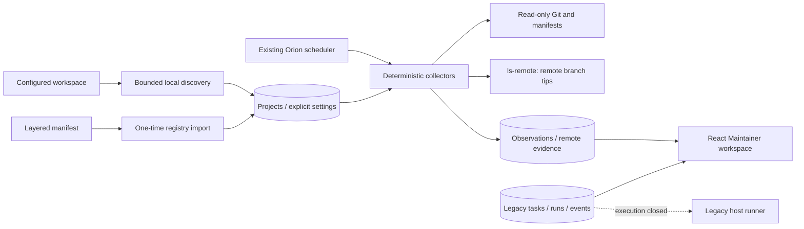
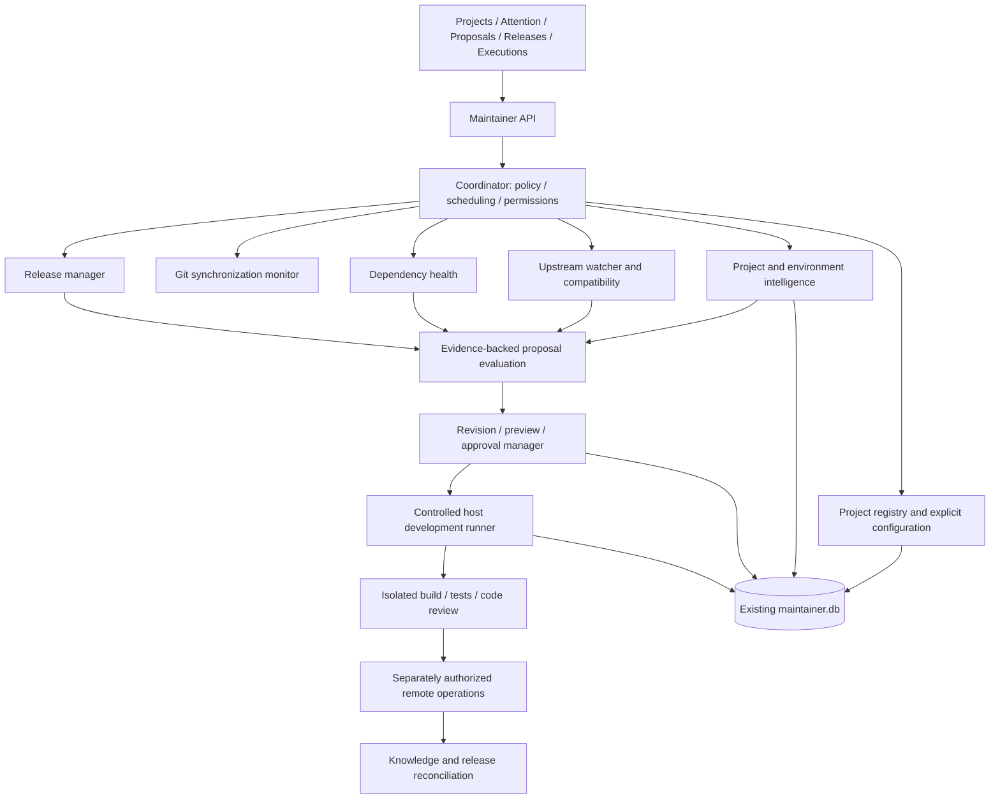
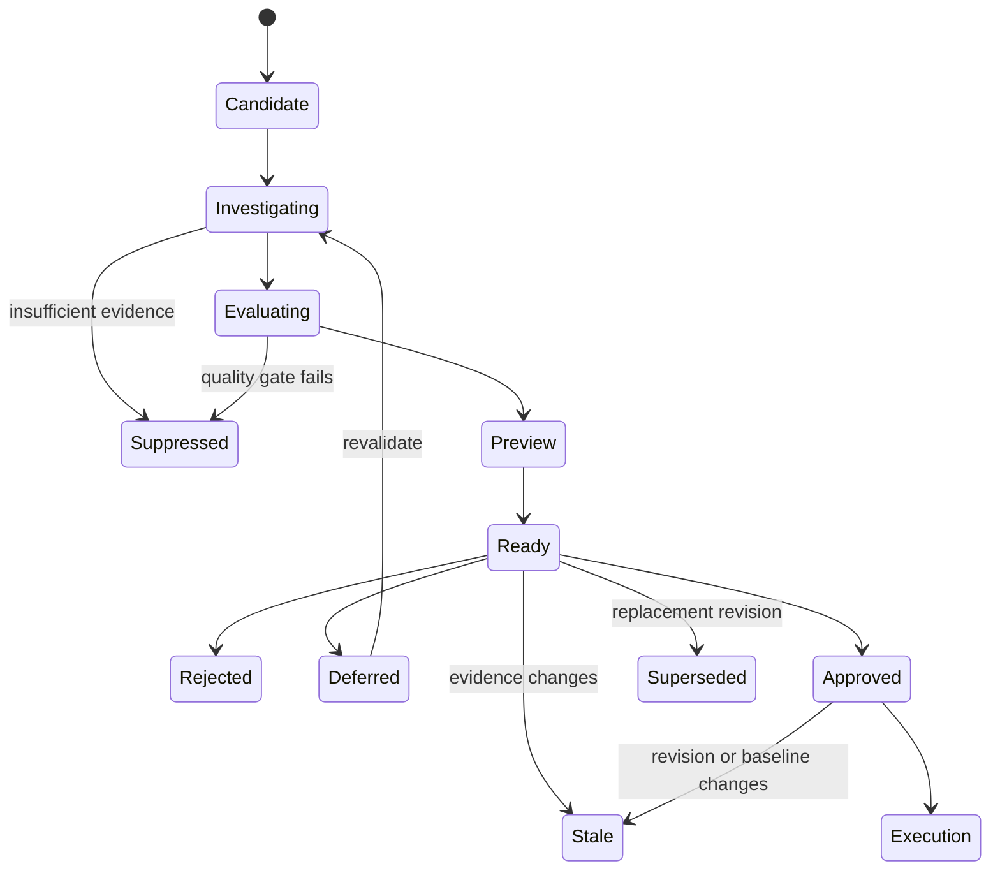
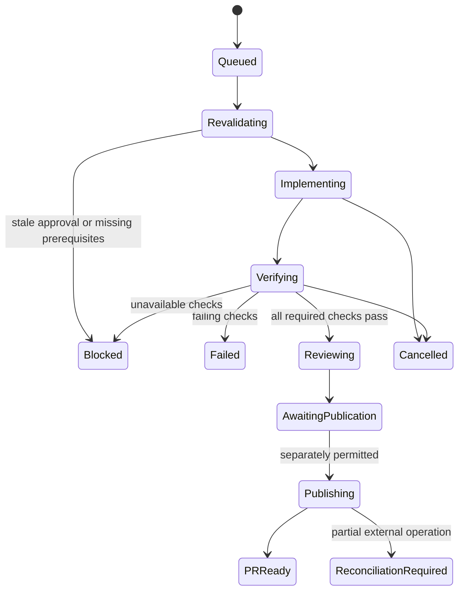
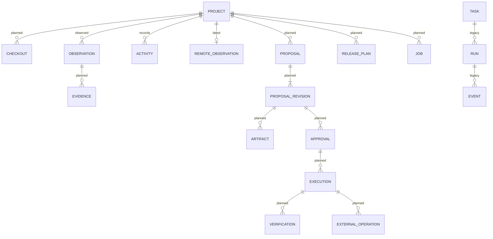

# Maintainer 2.0: repository-specific engineering intelligence

Status: approved direction; the monitoring foundation is implemented. Later phases below
remain planned. Reviewed against the repository and native host on 2026-11-27.

## Purpose and decisions

Maintainer must be useful before it writes code: show local work, uncertain remote state,
version metadata, environmental constraints and eventually evidence-backed opportunities.
Keep it inside Orion's plugin, SQLite and React stack. No additional service, vector database,
message broker or autonomous agent fleet is justified on this CPU-only, approximately 8 GB host.

Use deterministic collectors for Git, manifests, versions, jobs and permissions. Use the
existing model router only for interpretation of selected evidence, compatibility assessment,
proposal planning and review. A model never supplies a missing fact or authorizes an operation.

## Verified current system

| Concern | Evidence and assessment |
| --- | --- |
| Registration | `plugins/maintainer/repos.py:all_repos` reads layered `config/maintainer.json`; six legacy scan targets. Extend with stable persisted identity. |
| Analysis | `repos.digest` samples README, checkpoint notes, commits, TODOs and rotating source. `scan._propose` asks the configured reasoning provider for small briefs. Reusable context assembly, insufficient evidence/quality enforcement. |
| Persistence | `store.py` has tasks, runs, events, meta and scanned; WAL and busy timeout. Preserve this history; it is not an approval ledger. |
| Scheduling | `register()` uses `plugin_sdk.add_job`; core scheduler persists bounded history but not durable worker leases. Reuse triggers, add execution persistence before autonomous development. |
| Review | Inbox actions call `resolve_task`; legacy approval names a mutable brief, without revision/baseline/scopes. It must not authorize v2 execution. |
| Runner | `scripts/maintainer_runner.py:handle` prepares a host worktree, installs, calls Codex, verifies and publishes. Prior code published even after failed verification and recorded success. Publication and result gates are now fail-closed. |
| Isolation | Runner has `assert_safe`, `maintainer/*` branches and no merge path. Native systemd services do not enforce the old documented read-only Docker mount. Saved host CLI credentials remain a security boundary to redesign. |
| UI | `interfaces/spa/src/views/AgentDetail.tsx` and Inbox expose legacy queue/history. React 18, TypeScript, React Query, Vite and existing CSS tokens are the actual UI. Jinja is legacy. |
| API | Plugin FastAPI router is mounted under `/plugins/maintainer`. Runner endpoints use a bearer token. There is no verified owner authentication for the ordinary application APIs. |
| Observability | Execution events, heartbeat, sweep and Herald report contribution already exist. No durable cancellation, fencing, publication reconciliation or proposal provenance. |
| Verification | `tests/test_maintainer_codex.py` covers the prior runner and scan. New controlled-Git/API/release fixtures extend it. `pytest.ini` excludes the ignored `odysseus/` reference clone from default collection. |

The investigation found historical `done` runs with failed or blocked verification. Migration
keeps the original outcome in `runs.reported_status` and reassesses those runs as failed.
It preserves PR URLs and events; a past PR is not assumed to have passed verification.

### Existing workflow and deployed foundation



Reusable components: plugin SDK, scheduler triggers, provider router/cost tracking, Inbox,
Herald report sources, SQLite connection discipline, runner event feed, SPA tokens and queries.
Redesign: approvals, claim/execution transactions, execution isolation, retries and publication.
Missing: semantic knowledge, upstream assessment, dependency advisories, qualified proposals,
previews, release readiness, scoped external operations and crash-safe development jobs.
Eventually retire legacy title-only briefs, repeated full prompt reconstruction, disposable
in-memory execution state and the reusable-per-project destructive worktree preparation.

## Target boundaries



These boxes are Python module responsibilities, not separately deployed services. Begin with
one collection worker and one mutation worker. Split modules as their contracts become real.

| Deterministic | Model-assisted |
| --- | --- |
| Discovery, canonical paths, Git status, branch ancestry, file hashes, version parsing | Architecture interpretation with file/symbol evidence |
| Remote API/branch retrieval, manifests, advisory matching, lockfile changes | Upstream semantic relevance and fork conflict explanation |
| Identity, fact authority, freshness, invalidation, deduplication, scheduling | Opportunity discovery and implementation planning |
| Approval scope/revision checks, leases, commands, deadlines, verification results | Proposal critique, code review and grounded summaries |

## Registry, configuration and environment

`registry.py` introduces UUID identities, unique names and canonical checkout paths, explicit
settings, status (`active`, `paused`, `archived`), configuration revisions and activity history.
Manifest records seed the database once; subsequent manifest changes do not silently replace
owner edits. Discovery never changes existing settings. `PATCH /projects/{id}` uses optimistic
revision checking. Paths must resolve beneath the configured workspace, including symlinks.
Missing paths remain registered and observable; editing a path repairs identity in place.

Workspace discovery stops at a Git root, excludes hidden/generated/dependency/archive paths,
does not follow directory symlinks, and bounds depth, visited directories and project count.
Discovered projects are monitoring-only; discovery grants no execution authorization.

The present record supports one checkout per project. Phase 1 extension separates physical
checkouts from logical identity before supporting multiple clones. Add explicit provider,
default branch, classification, upstream relationship, development commands and monitoring
preferences in typed settings. Do not duplicate owner settings in another configuration file;
provide explicit import/export and a reviewed manifest-update diff instead.

Environment inventory calls a fixed allowlist of installed tool version/SDK-list commands
outside project directories, cached for 24 hours. It does not execute package scripts, install
hooks or arbitrary configured commands. A `dotnet` executable without SDKs is not ready.
Tool presence, a running deployed binary and build readiness are different observations.
Inventory currently describes the Orion service host; a future runner reports its own
environment ID. Record required services and environment variable names only, never values.

## Knowledge and evidence

The implemented initial profile contains stack/manifests, component versions, manifest hashes,
Git revision, working-tree status fingerprint, environment and explicit configuration revision.
Build/test/dependency health stays unknown until verified; no dashboard numbers are invented.

Expand to structured modules, API surfaces, migrations, integrations, constraints, roadmap,
defects and fork modifications. Store facts with authority (`owner`, `discovered`, `inferred`),
verification state, source path/symbol/blob, branch and commit, observation time and expiry.
Never silently promote inference to an explicit fact or into Orion's World Model.

Committed knowledge keys on `(project, branch/ref, commit, collector version)`. Working-tree
overlays key separately on index/worktree/file fingerprints and expire when that state changes.
On a new commit, analyze changed paths, invalidate dependent facts and refresh affected
modules. Manifest, migration and architecture-document changes trigger their own collectors.
Dirty content must not be presented as the content of a commit. Reconcile periodically.

Keep structured JSON plus relational evidence links in SQLite. Add FTS only when concrete
retrieval needs warrant it; existing source excerpts are bounded. Embeddings/vector storage
are deferred. Model requests receive selected evidence IDs, not an entire repository.

## Git synchronization

`intelligence.git_observation` uses optional-lock-free porcelain v2 with fsmonitor disabled.
It reports staged/unstaged/untracked/conflicted counts, branch/tracking, detached state,
operations in progress, branches without tracking and cached ahead/behind simultaneously.
Read-only tests check that inspection does not refresh the index.

`verify_remote` uses `ls-remote` against supported HTTPS/SSH origin transports, with promptless
credentials, timeouts and redacted display URLs. It does not fetch into a development checkout.
Remote success time, attempted time and failure are distinct. A failed request retains prior
evidence but reports unavailable. Freshness expires at read time. A changed origin invalidates
previous evidence; a changed remote SHA reports `tracking_ref_changed`, never guessed counts.
Matching fresh remote/tracking SHAs plus zero cached ahead/behind establish branch sync, not
cleanliness, build health or sync of every local branch. Current remote verification covers
origin; other tracking remotes remain unknown.

For ancestry involving missing remote objects, add an owned bare cache outside user checkouts.
Fetch only there; import local commit objects into that cache without changing the source.
Record cache-fetch authorization separately from source checkout access. Monitoring never
pulls, stashes, commits, rebases, resets, pushes or changes the user's branch.

## Upstream intelligence

Verified examples: `Perseus` has an upstream remote pointing to `meltforce/FreeReps`.
`noxberry` documentation identifies Strawberry; its checkout has no upstream remote.
`noxberry/cmake/Version.cmake` declares 1.2.31 and the build uses C++, Qt and CMake.
These are baseline observations, not claims about the latest upstream release.

Persist explicit upstream URL/ref, last integrated SHA (unknown is valid), release baseline,
integration preference, fork modifications and regression areas. Record the evidence used for
automatic discovery, and ask for baseline confirmation if documentation is ambiguous.
Watch tags/releases/commits/advisories with provider adapters, ETags, deduplication and backoff.
Assess merge bases, ancestry, patch equivalence and overlapping files before semantic review.
Commit counts alone cannot determine compatibility, especially for rebased/squashed forks.

An integration proposal includes old/new baseline, relevant fixes/features, overlap with fork
customizations, dependency/toolchain changes, effort, risks and build/regression requirements.
Merge, isolated rebase, cherry-pick, manual adaptation, defer and skip are all valid outcomes.
For NoxBerry, preserve fork behavior and confirm Qt/CMake/compiler availability before proposing
an executable plan. Upstream compatibility and retrieval are not yet implemented.

## Versions, releases and dependency health

Release policy is project-specific: semantic, calendar or unversioned; version metadata path,
tag prefix and release branch. Discovery does not impose one application version on every
package in a monorepo. Observed package versions and local tags are not remote releases.
The foundation supports package.json components, Orion's version and Strawberry CMake version;
unsupported metadata remains unknown. Readiness additionally needs baseline, release policy,
consistent metadata/tag/release evidence, changelog coverage and current verification.

Examples from investigation: FinStrive's root and frontend have distinct versions; NoxBerry's
version is inherited from upstream; Orion has commits after its last release tag. Do not bump
every project now or treat these observations alone as defects. A fork may choose a separate
downstream version while retaining upstream baseline metadata.

`scripts/release.py` now prepares metadata by default. Commit, local tag and push require
explicit flags; `--unreleased` records changes without bumping a version. It no longer stages
the entire tree or pushes unrelated tags. `/health.build` records commit and dirty-at-start
independently of the release version. See `../VERSIONING.md`.

Future release plans bind metadata changes, version, base revision, validation and publication
scope. Preparation occurs in an approved isolated branch/PR. Remote tags, publication and
deployment each require explicit scope. Track external operation IDs and reconcile partial
success; never overwrite conflicting tags or retry a push blindly after a lost response.

Dependency adapters should inspect manifests/locks and reliable advisories per ecosystem.
Separate security fixes, useful maintenance, routine updates and breaking/incompatible changes.
Use lockfile/revision caching and advisory timestamps. Outdated is not synonymous with broken;
release inactivity alone does not establish abandonment. No advisory collector is enabled yet.

## Proposals, previews and approvals

The old scan is paused by shipped configuration. Existing briefs/history remain readable and
rejectable; old approvals remain stored but cannot be claimed. This avoids generating more
low-evidence briefs while the replacement is built. Zero qualified proposals is success.

Persist candidates separately from user-visible revisions. A quality gate requires a concrete
problem, valid evidence, absence of an equivalent capability, architecture fit, practical value,
feasibility, available verification, known risks and no duplicate/rejected equivalent. Missing
evidence suppresses the candidate, rather than requiring the user to investigate it.
Deduplicate by project/problem/evidence fingerprint and retain dismissals. Reconsider rejected
work only with materially new evidence. Provider failure is not a successful empty analysis.

Each published revision contains identity/category/priority, baseline, existing behavior,
evidence, affected workflow, solution/scope/non-goals/alternatives, value/effort/uncertainty,
paths/symbols/implementation sequence, API/data/dependency changes, risks/migration/rollback,
verification/acceptance, a meaningful preview and exact authorization requested.



UI preview artifacts use existing screenshots/components or static HTML/SVG mockups matching
the project's design system. Backend equivalents use request/response examples, state/data-flow
diagrams and sample reports. Mark conceptual artifacts explicitly. Store content hashes,
revision association and tool provenance; changing a revision invalidates its previews and
approval. Serve script-free artifacts from confined storage; reject arbitrary embedded HTML.

Approval is an immutable record of proposal revision, baseline SHA, scope hash, verification
plan hash, permitted local/external operations, owner, expiry and revocation. Approval for
implementation does not imply branch push, PR creation, remote tag, publication or deployment.
Prompt text, repository instructions and command output cannot add permissions.

## Execution, recovery and security



Use a per-project lock plus one global mutation slot initially. Claims and execution creation
must share one transaction. Persist leases/fencing tokens, ownership, stage transitions,
heartbeat, commands, exit codes, verification evidence and external operations. Heartbeat
during install/build/publish too, terminate process groups on cancellation/timeouts, and keep
failed worktrees/evidence for recovery. A retry resumes or explicitly creates another attempt;
it does not blindly repeat external writes. Reap orphaned worktrees only with an ownership
record, confinement checks and a retention decision. Never force-push or clean user branches.

Use a distinct owned worktree per execution based on managed Git objects, not reusable
destructive preparation that fetches in the normal checkout. Privileged decisions live in
validated Python policies, not model output. Separate publisher credentials from untrusted
build/test/install execution. Environment scrubbing is useful but not a filesystem sandbox:
saved host tokens, sockets, SSH agents and home files require restricted mounts/network and
credential separation. Bubblewrap is installed but a functioning isolation policy has not
been verified. Do not enable autonomous development until that policy and owner authentication
are implemented and tested. These are blocking phase-6 prerequisites, not permission prompts
for read-only monitoring.

## Persistence and API contracts

Implemented tables are `projects`, `project_observations`, `project_remote_observations`,
`project_activity`, plus all legacy tables. Project configuration revision is authoritative;
observations are historical, scoped evidence, not configuration. Observations keep at most
144 rows per project. Remote evidence stores last success separately from last attempt/error.
SQLite foreign keys are enabled on registry connections. Transactions and unique constraints
protect identity; optimistic revision checks prevent lost owner edits.



The diagram's explicitly planned entities are not claims of deployed tables. Consolidate
profiles/findings/upstream/release/dependency observations by kind until query needs justify
separate tables. Add unique `(project, kind, fingerprint)` findings, `(proposal, revision)`
revisions, content-hash artifacts, approval scope indexes, one active execution per project,
unique job idempotency keys and external-operation keys. Retain approvals/mutation audit and
verification longer than noisy source excerpts; redact/bound logs before persistence.

Implemented routes, all under `/plugins/maintainer`:

| Method/route | Contract |
| --- | --- |
| GET `/projects` | Registered projects, latest observations/freshness, refresh state, capability flags, execution pause. Bounded workspace inventory. |
| POST `/projects/refresh` | `{ "discover": false, "remote": false }`; HTTP 202, bounded background inspection. Duplicate in-process work defers. |
| PATCH `/projects/{id}` | `{ "revision": 1, "status": "paused", "path": "...", "settings": { "release": {...} } }`; 404 missing, 409 stale/path conflict, 422 schema failure. No command execution. |
| GET `/tasks`, `/runs`, `/runs/{id}` | Preserved legacy records/events; existing contracts retained. |
| POST `/tasks/{id}` | Reject/dismiss supported; approve returns 409 while migration is paused. |
| POST `/runner/claim` | Bearer required; returns `{ "task": null, "paused": true }`. Legacy grants never become v2 grants. |
| POST `/runner/runs/{id}/result` | Successful result additionally requires passing verification or explicit zero-change/skipped. |

Future `/proposals/{id}/revisions`, `/decisions`, `/executions`, `/events?after_id=`,
`/cancel`, `/release-plans` and `/runner/v2/claim` use validated schemas, owner auth,
idempotency keys and revision preconditions. Return 409 for stale scope/baseline, 403 for
unauthorized operations, 422 for invalid inputs and 202 for durable jobs. Lists need cursor
pagination before unbounded histories are exposed. Runner callbacks must carry assigned
execution identity and fencing token, not only a shared installation token.

## Scheduling, cost and operational visibility

Today local observation runs every 10 minutes; remote tips hourly at minute 23; environment
checks cache for 24 hours. Existing scheduler/UI allow retuning cron. Explicit discovery is
separate from routine monitoring. Commands are bounded, collection runs in a worker thread,
and one in-process lock prevents overlapping scans. Manual requests run in-process after the
response; they are not yet restart-durable. A restart may lose one inspection, recovered by
the next scheduled pass. The scheduler's histories and refresh metadata expose failures.

Before executing work, add durable jobs with project/kind/idempotency keys, leases, stage
checkpoints, bounded retries/backoff, rate-limit state, cancellation and stale-job recovery.
Prioritize user refresh and recovery over opportunity generation. Run dependency security
checks daily, routine upgrade review weekly, upstream monitoring daily, release reconciliation
after integration, and model opportunity review at most weekly when evidence changes.
Use the existing router's cost accounting plus per-job token/time limits, schema validation,
bounded retries and evidence retrieval. Avoid model calls for deterministic monitoring.

Expose last successful inspection, attempted/verified remote time, source ref, triggering job,
candidate suppression reason, model/provider/token accounting, approval scope, command exit
codes, verification plan, published artifacts and recovery action. Correlate project/proposal/
execution/job IDs. Add project findings to Herald only on stable finding transitions, with
deduplication/resolution, so repeated polling does not create notification noise.

## Frontend and migration

The workspace lives within the existing agent page at `/agents/maintainer`, reached through
Agents → Maintainer. The old `/maintainer` route redirects there with query/hash preserved;
there is no separate sidebar entry. It reuses Orion tokens and Shell. Tabs: Projects, Attention, Releases,
Proposals, Executions. Project selection provides Git facts, version components, environment
and evidence, and explicit policy/path/status editing. Preserved proposal review clearly says
execution is paused. Execution detail exposes verification output and recorded events.
Loading, unavailable, unknown, stale and empty states are distinct; there is no fabricated
health score. Agent status, project workspace, schedule and activity share the same page;
a schedule anchor avoids scrolling through the project directory to reach job controls.

Representative layout:

```text
Agents → Maintainer                  Schedule and activity ↓
[Inspect projects] [Verify remotes] [Discover projects]  last inspection
Projects | Need attention | Tracking verified in sync | Missing/stale
Projects  Attention  Releases  Proposals  Executions
[Find project, path or stack]
Project cards: branch, stack, multiple findings, observation/remote freshness
Selected project:
  Git / origin / cached counts        Versions / local tags / unknown checks
  Environment and evidence            Configuration + revision-aware save
```

Migration is additive: Guardian snapshot first, preserve legacy task IDs/PRs/events/config,
import manifest facts once, add registry tables, close legacy claims, reassess bad outcomes
without losing reported status, then collect and deploy the SPA. New proposal/execution
tables coexist with legacy read adapters. A rollback must keep execution paused; rolling
back to the old runner/API can reopen unsafe claims. Restore data from the pre-migration
snapshot only with an explicit recovery decision, preserving newer owner edits first.

## Alternatives, constraints and acceptance

Rejected: microservices/broker (operational cost), a new database/vector service (no proven
retrieval need), many independent agents (duplicated context), automatic fetch in developer
checkouts (unapproved metadata mutation), version-per-push (noise), a generic AI score and
proposal quotas (untrustworthy value). `ls-remote` is the first remote-verification adapter;
an owned cache follows when object-level comparison becomes necessary.

Verified constraints: Go is unavailable and `dotnet` has no listed SDKs on this host;
environment readiness must remain explicit. No latest upstream release, dependency advisory,
remote release publication or successful application build has been assumed from local tags.
Open decisions: fork baselines/downstream version conventions, release publishing destinations,
owner authentication and execution isolation policy. These do not block local monitoring.
Implementation details and independently verifiable acceptance criteria are in `ROADMAP.md`.

Foundation acceptance: own projects are registered persistently; inspection preserves dirty
work and index metadata; remote success is never inferred from stale refs; environment and
versions cite paths/timestamps; no release is created by a normal development commit; failed
verification cannot publish through the runner; legacy approvals cannot be claimed; the new
workspace builds and renders; existing Orion tests and live smoke checks pass. Later-phase
capabilities must remain visibly unavailable until implemented and verified.
